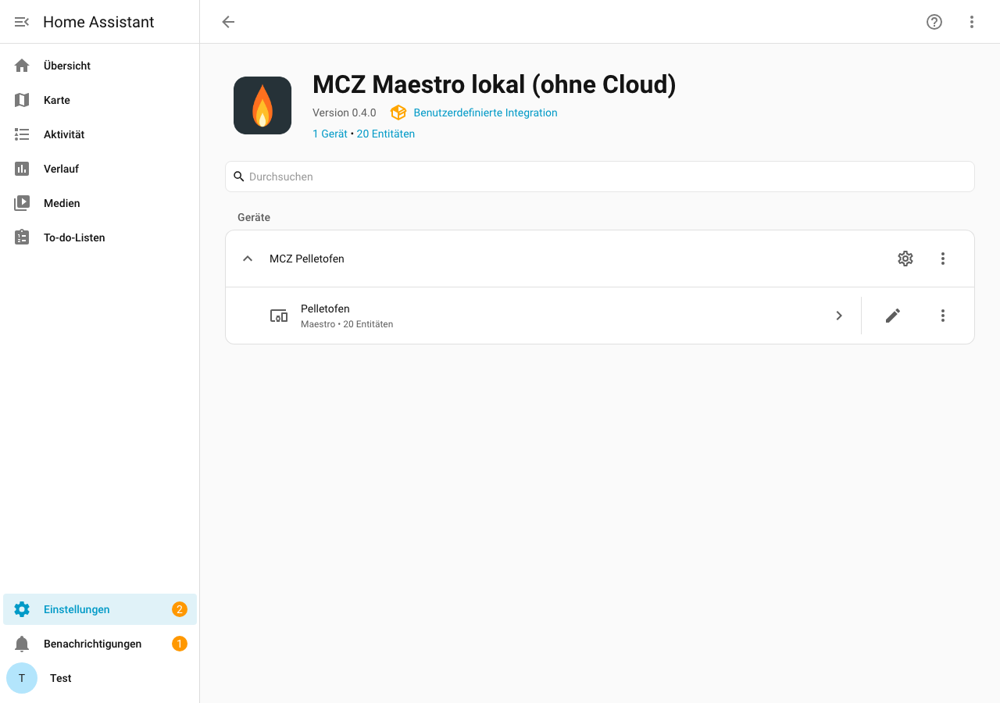
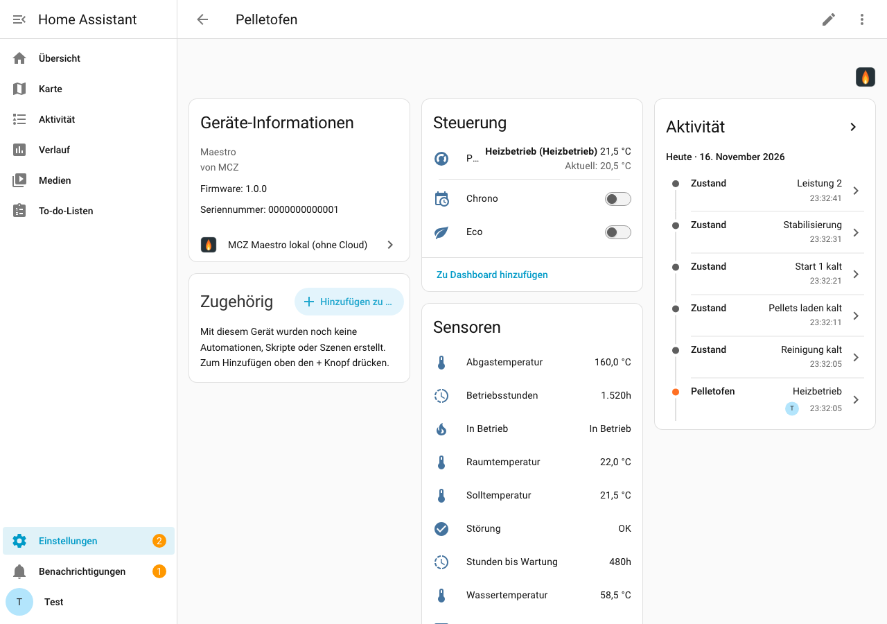
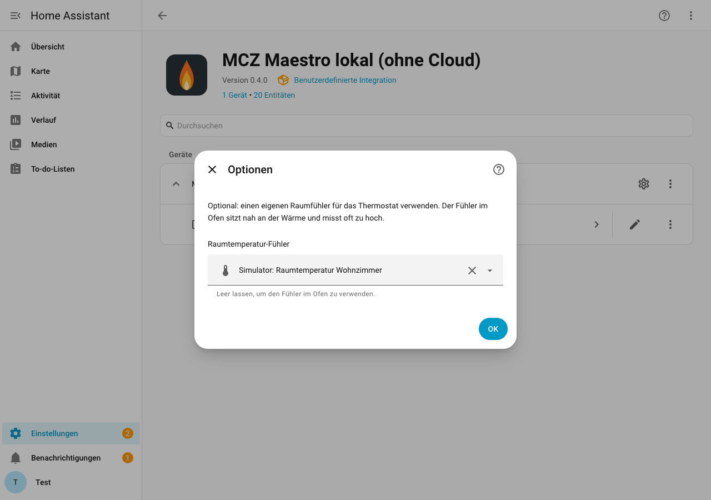
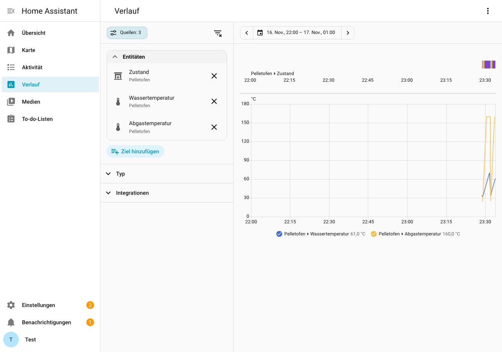

# Handbuch: MCZ Maestro lokal (ohne Cloud)

> ⚠️ **Stand 0.4.0.** Lesen und Schalten sind eingebaut. Schalten ist **nur simuliert getestet**, noch nicht am echten Ofen. Das Lesen ist mit einem echten Ofen getestet (Werte stimmen mit der Ofenanzeige), die Integration als Ganzes noch nicht. Alle Bilder stammen aus einer simulierten Test-Instanz.

## Was die Integration macht
Das WLAN-Modul (Maestro) im Ofen meldet sich von selbst beim MCZ-Server. Wenn dein Router diese Verbindung auf Home Assistant umleitet, übernimmt diese Integration die Rolle des Servers. Home Assistant fragt dann alle 10 Sekunden den Zustand des Ofens ab. Eine Internetverbindung braucht es dafür nicht.

**Wichtig:** Solange die Umleitung aktiv ist, funktioniert die MCZ-App nicht mehr.

## Einrichten
1. Integration installieren (später über *Einstellungen → Marketplace*).
2. *Einstellungen → Geräte & Dienste → Integration hinzufügen → „MCZ Maestro lokal“*.
3. Port eingeben (Standard **9000**, wie beim MCZ-Server). Nur ändern, wenn auf Home Assistant schon etwas diesen Port benutzt; dann muss der Router auf den neuen Port umleiten.
4. Umleitung im Router einrichten (Anleitung folgt in `docs/NETZWERK.md`).
5. Die Umleitung wirkt nur auf **neue** Verbindungen. Den Ofen deshalb einmal kurz stromlos machen; danach meldet er sich innerhalb einer Minute.
6. Wird die Umleitung wieder entfernt, verbindet sich der Ofen von selbst wieder mit der MCZ-Cloud, sobald diese Integration die Verbindung schließt (z. B. Integration deaktivieren).

## Was du siehst
Das Gerät **Pelletofen** mit Seriennummer und Firmware des Moduls (werden bei der ersten Anmeldung des Ofens eingetragen):

| Entität | Bedeutung |
|---|---|
| Zustand | Was der Ofen gerade macht, z. B. *Aus*, *Start 1 kalt*, *Leistung 2*, *Abkühlen*, *Störung* |
| Wassertemperatur | Kesselwasser (Hydro-Öfen) |
| Raumtemperatur | Fühler im Ofen. Achtung: Er sitzt nah an der Wärmequelle und kann deutlich zu hoch messen. Für Automationen besser einen eigenen Raumfühler verwenden |
| Solltemperatur | am Ofen eingestellte Wunschtemperatur |
| Abgastemperatur | im Abgasrohr |
| Rücklauf-/Puffertemperatur | nur wenn der Fühler angeschlossen ist |
| Zündungen | Zähler aller Zündvorgänge; steigt er schnell, taktet der Ofen |
| Betriebsstunden, Stunden bis Wartung | Zähler des Ofens |
| In Betrieb | *Ein*, solange der Ofen zündet oder brennt |
| Störung | *Problem*, wenn der Ofen einen Alarm (A01 …) meldet |
| Verbunden | ob der Ofen gerade mit Home Assistant verbunden ist |
| Diagnose (Zustandsnummer, Leistungsstufe, Pumpe, Abgasgebläse, Platinentemperatur) | Rohwerte für die Fehlersuche |

Ist der Ofen **nicht verbunden**, zeigen alle Werte „Nicht verfügbar“, nur *Verbunden* steht auf *Getrennt*.

## Bedienen
Das Thermostat **Pelletofen** schaltet den Ofen ein und aus und stellt die Solltemperatur ein (5 bis 30 °C in halben Grad). Dazu kommen die Schalter **Eco**, **Chrono** und **Töne**.

**Schutzgrenzen** (fest eingebaut, nicht abschaltbar):
- Befehle gehen nur raus, wenn der Ofen verbunden ist.
- Meldet der Ofen eine Störung, schaltet Home Assistant ihn nicht ein. Die Störung muss zuerst am Ofen quittiert werden.
- **Schutz gegen Takten:** Nach dem Ausgehen (egal ob durch Home Assistant, am Ofen selbst oder durch das Chrono) darf der Ofen erst nach **30 Minuten** wieder eingeschaltet werden. Home Assistant meldet sonst, wie lange es noch dauert. Die Sperre bleibt auch über einen Neustart von Home Assistant erhalten.
- Höchstens ein Befehl pro Sekunde.

**Achtung bei Chrono:** Ist Chrono am Ofen eingeschaltet, schaltet der Ofen zusätzlich nach seinem eigenen Zeitplan. Wenn Home Assistant steuern soll, Chrono ausschalten, damit nur eine Stelle steuert.

## Eigener Raumfühler
Unter *Einstellungen → Geräte & Dienste → MCZ Maestro lokal → Zahnrad (Konfigurieren)* lässt sich ein eigener Temperaturfühler wählen. Das Thermostat zeigt dann dessen Wert als Ist-Temperatur. Der Fühler im Ofen bleibt als eigener Sensor erhalten. Wird der Fühler später umbenannt, bleibt die Zuordnung bestehen.

Hinweis: Der Ofen selbst regelt weiterhin nach seinem eingebauten Fühler. Der eigene Raumfühler ist vorerst nur Anzeige; die Regelung danach kommt mit der Heizungssteuerung.

## Verlauf
Zustand und Temperaturen landen im Verlauf von Home Assistant, z. B. um zu sehen, wie oft der Ofen zündet:

## Wenn etwas nicht geht
- **„Port lässt sich nicht öffnen“:** Ein anderes Programm benutzt den Port. Anderen Port wählen (Integration löschen und neu hinzufügen) und die Umleitung im Router anpassen.
- **Verbunden bleibt auf *Getrennt*:** Umleitung im Router prüfen. Liegen Ofen und Home Assistant im **selben Netz**, braucht es zusätzlich eine Masquerade-Regel (siehe `docs/NETZWERK.md`). Ofen kurz stromlos machen.
