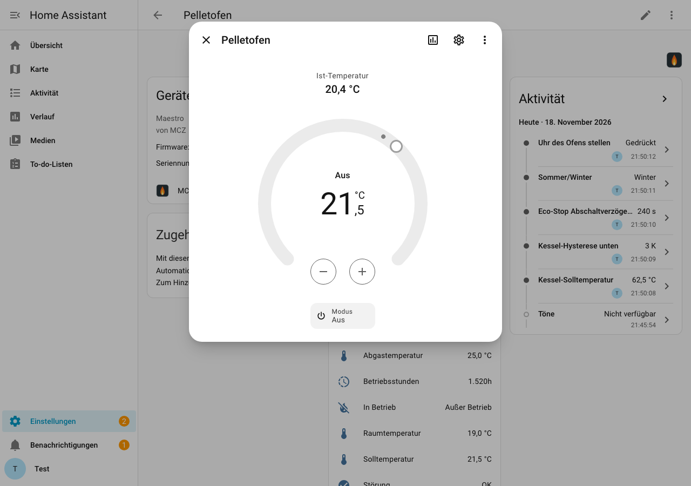
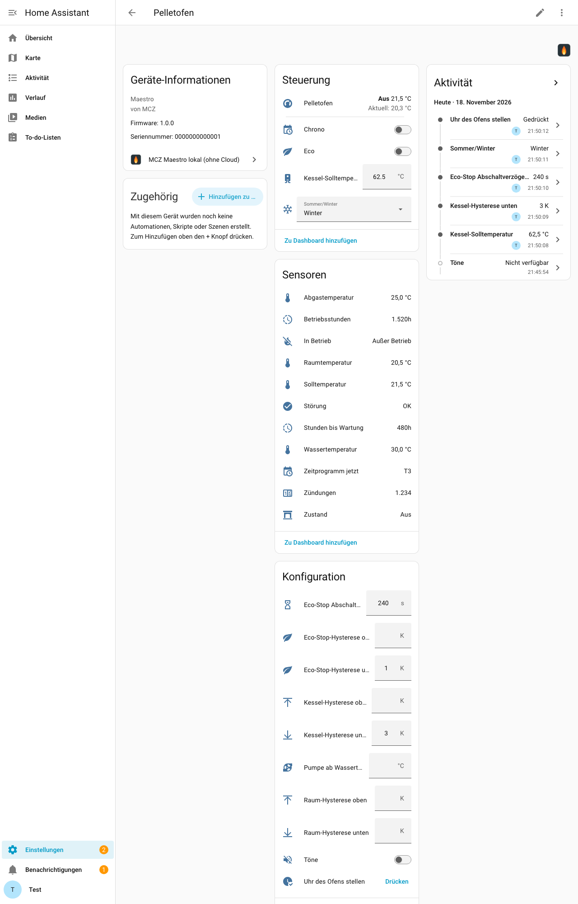

# Handbuch: MCZ Maestro lokal (ohne Cloud)

> ⚠️ **Stand 0.5.0.** Lesen, Schalten und alle Einstellungen der MCZ-App für den Alltag sind eingebaut. Schalten ist **nur simuliert getestet**, noch nicht am echten Ofen. Die Befehle stammen aus einem Mitschnitt mit der MCZ-App am echten Ofen (siehe `docs/PROTOKOLL.md`). Das Lesen ist mit einem echten Ofen getestet (Werte stimmen mit der Ofenanzeige), die Integration als Ganzes noch nicht. Alle Bilder stammen aus einer simulierten Test-Instanz.

## Was die Integration macht
Das WLAN-Modul (Maestro) im Ofen meldet sich von selbst beim MCZ-Server. Wenn dein Router diese Verbindung auf Home Assistant umleitet, übernimmt diese Integration die Rolle des Servers. Home Assistant fragt dann alle 10 Sekunden den Zustand des Ofens ab. Eine Internetverbindung braucht es dafür nicht.

**Wichtig:** Solange die Umleitung aktiv ist, funktioniert die MCZ-App nicht mehr.

## Einrichten
1. Integration installieren (später über *Einstellungen → Marketplace*).
2. *Einstellungen → Geräte & Dienste → Integration hinzufügen → „MCZ Maestro lokal“*.
3. Port eingeben (Standard **9000**, wie beim MCZ-Server). Nur ändern, wenn auf Home Assistant schon etwas diesen Port benutzt; dann muss der Router auf den neuen Port umleiten.
4. Umleitung im Router einrichten: siehe [NETZWERK.md](NETZWERK.md), mit Beispielen für verschiedene Router. Meldet sich der Ofen 10 Minuten nach dem Einrichten nicht, erscheint unter *Einstellungen → Reparaturen* ein Hinweis.
5. Die Umleitung wirkt nur auf **neue** Verbindungen. Den Ofen deshalb einmal kurz stromlos machen; danach meldet er sich innerhalb einer Minute.
6. Wird die Umleitung wieder entfernt, verbindet sich der Ofen von selbst wieder mit der MCZ-Cloud, sobald diese Integration die Verbindung schließt (z. B. Integration deaktivieren).


## Was du siehst
Das Gerät **Pelletofen** mit Seriennummer und Firmware des Moduls (werden bei der ersten Anmeldung des Ofens eingetragen):


| Entität | Bedeutung |
|---|---|
| Zustand | Was der Ofen gerade macht, z. B. *Aus*, *Start 1 kalt*, *Leistung 2*, *Abkühlen*, *Störung* |
| Wassertemperatur | Kesselwasser (Hydro-Öfen) |
| Raumtemperatur | Fühler im Ofen. Achtung: Er sitzt nah an der Wärmequelle und kann deutlich zu hoch messen. Für Automationen besser einen eigenen Raumfühler verwenden |
| Solltemperatur | am Ofen eingestellte Wunschtemperatur |
| Abgastemperatur | im Abgasrohr |
| Rücklauf-/Puffertemperatur | nur wenn der Fühler angeschlossen ist |
| Zündungen | Zähler aller Zündvorgänge; steigt er schnell, taktet der Ofen |
| Betriebsstunden, Stunden bis Wartung | Zähler des Ofens |
| In Betrieb | *Ein*, solange der Ofen zündet oder brennt |
| Störung | *Problem*, wenn der Ofen einen Alarm (A01 …) meldet |
| Verbunden | ob der Ofen gerade mit Home Assistant verbunden ist |
| Diagnose (Zustandsnummer, Leistungsstufe, Pumpe, Abgasgebläse, Platinentemperatur) | Rohwerte für die Fehlersuche |

Ist der Ofen **nicht verbunden**, zeigen alle Werte „Nicht verfügbar“, nur *Verbunden* steht auf *Getrennt*.

## Bedienen
Das Thermostat **Pelletofen** schaltet den Ofen ein und aus und stellt die Solltemperatur ein (5 bis 30 °C in halben Grad). Dazu kommen die Schalter **Eco**, **Chrono** und **Töne**.



**Schutzgrenzen** (fest eingebaut, nicht abschaltbar):
- Befehle gehen nur raus, wenn der Ofen verbunden ist.
- Meldet der Ofen eine Störung, schaltet Home Assistant ihn nicht ein. Die Störung muss zuerst am Ofen quittiert werden.
- **Schutz gegen Takten:** Nach dem Ausgehen (egal ob durch Home Assistant, am Ofen selbst oder durch das Chrono) darf der Ofen erst nach **30 Minuten** wieder eingeschaltet werden. Home Assistant meldet sonst, wie lange es noch dauert. Die Sperre bleibt auch über einen Neustart von Home Assistant erhalten.
- Höchstens ein Befehl pro Sekunde.

**Achtung bei Chrono:** Ist Chrono am Ofen eingeschaltet, schaltet der Ofen zusätzlich nach seinem eigenen Zeitplan und übernimmt die Solltemperatur aus dem Zeitprogramm (T1/T2/T3). Wenn Home Assistant steuern soll, Chrono ausschalten, damit nur eine Stelle steuert.

## Kessel, Sommer/Winter und Feineinstellungen
Alles, was die MCZ-App im Alltag einstellt, gibt es auch hier:

| Entität | Bedeutung |
|---|---|
| **Kessel-Solltemperatur** | Wie heiß das Wasser werden soll (50–80 °C, halbe Grad) |
| **Sommer/Winter** | Winter = Heizbetrieb. Der Ofen meldet das nicht zurück; angezeigt wird, was zuletzt über Home Assistant gesetzt wurde |
| Kessel-Hysterese oben / unten | Bis wie viele Grad über dem Kessel-Soll der Ofen weiterläuft und ab wie vielen Grad darunter er wieder hochregelt. Ein kleiner Bereich (z. B. +0 / −2) lässt den Ofen oft takten |
| Raum-Hysterese oben / unten | Dasselbe für die Raumtemperatur |
| Eco-Stop-Hysterese oben / unten, Eco-Stop Abschaltverzögerung | Wann Eco-Stop den Ofen ganz ausschaltet und wie lange er vorher wartet |
| Pumpe ab Wassertemperatur | Ab dieser Wassertemperatur läuft die Umwälzpumpe |
| Uhr des Ofens stellen | Knopf; stellt Datum und Uhrzeit auf die Zeit von Home Assistant |
| Zeitprogramm jetzt | Welche Stufe des Zeitprogramms gerade gilt; in den Attributen das ganze Programm je Wochentag und T1/T2/T3 |
| Quelle Raumfühler (Diagnose) | Woher der Ofen die Raumtemperatur nimmt. Nur Anzeige |

Die Feineinstellungen stehen unter *Konfiguration*. Der Ofen meldet die meisten davon nicht zurück: Das Feld bleibt leer, bis du den Wert einmal hier setzt. Den aktuellen Wert findest du notfalls in der MCZ-App oder am Bedienfeld. Eco-Stop-Verzögerung und Eco-Stop-Hysterese unten meldet der Ofen selbst.



**Grenzen:** Jeder Wert nur in einem sicheren Bereich (z. B. Kessel 50–80 °C, Pumpe 40–70 °C). **Nicht einstellbar** sind die Quelle des Raumfühlers, der Relais-Ausgang und der Pelletstand-Sensor: Das ist die Verdrahtung der Anlage, ein falscher Wert legt die Regelung lahm.

## Zeitprogramm setzen
Mit dem Dienst **MCZ Maestro lokal: Zeitprogramm setzen** (`mcz_local.set_chrono_day`). Jeder Abschnitt gilt bis zum nächsten, Uhrzeiten nur zur vollen oder halben Stunde. Beispiel für Montag bis Freitag:

```yaml
action: mcz_local.set_chrono_day
data:
  days: [mon, tue, wed, thu, fri]
  program:
    - {start: "00:00", level: t1}
    - {start: "06:00", level: t3}
    - {start: "22:00", level: t1}
```

Stufen: `off`, `t1`, `t2`, `t3`. Vor dem ersten Abschnitt ist der Ofen aus.

## Uhr des Ofens
Ab Werk stellt die Integration die Uhr des Ofens bei jeder Anmeldung und danach alle 6 Stunden, damit das Zeitprogramm auch nach der Zeitumstellung stimmt. Abschalten: *Konfigurieren → Uhr des Ofens automatisch stellen*.

## Eigener Raumfühler
Unter *Einstellungen → Geräte & Dienste → MCZ Maestro lokal → Zahnrad (Konfigurieren)* lässt sich ein eigener Temperaturfühler wählen. Das Thermostat zeigt dann dessen Wert als Ist-Temperatur. Der Fühler im Ofen bleibt als eigener Sensor erhalten. Wird der Fühler später umbenannt, bleibt die Zuordnung bestehen.


Hinweis: Der Ofen selbst regelt weiterhin nach seinem eingebauten Fühler. Der eigene Raumfühler ist vorerst nur Anzeige; die Regelung danach kommt mit der Heizungssteuerung.

## Verlauf
Zustand und Temperaturen landen im Verlauf von Home Assistant, z. B. um zu sehen, wie oft der Ofen zündet:


## Wenn etwas nicht geht
- **„Port lässt sich nicht öffnen“:** Ein anderes Programm benutzt den Port. Anderen Port wählen (Integration löschen und neu hinzufügen) und die Umleitung im Router anpassen.
- **Verbunden bleibt auf *Getrennt*:** Umleitung im Router prüfen. Liegen Ofen und Home Assistant im **selben Netz**, braucht es zusätzlich eine Masquerade-Regel (siehe `docs/NETZWERK.md`). Ofen kurz stromlos machen.
